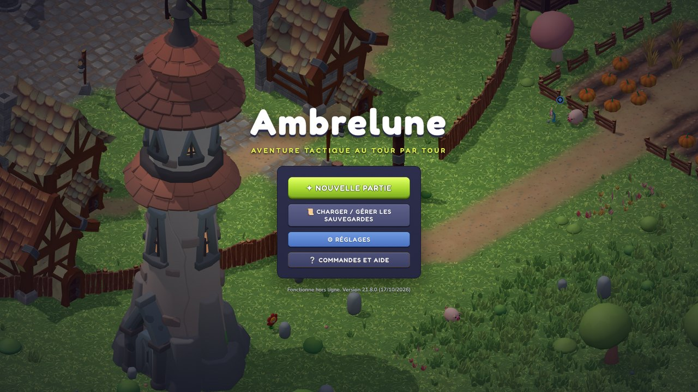

# Ambrelune

**Ambrelune** est une aventure tactique au tour par tour en 3D, dans un monde coloré au style « mignon ». On explore librement un grand monde ouvert de treize régions, on parle aux habitants et on accepte leurs quêtes. Les groupes de monstres sont visibles sur la carte, et les combats se jouent sur une grille, à la manière de *Dofus* : points d'action et de mouvement, portée, ligne de vue et éléments. Quatre classes de 20 sorts chacune sont proposées : le Lamier au corps à corps, l'Archelin à l'arc, la Sylvane qui soigne et le Démoniste qui invoque. À chaque niveau, on choisit une carte parmi trois, si bien que chaque personnage évolue différemment. Le jeu se joue en solo, entièrement hors ligne et en français, avec des donjons à boss, une tour de 100 étages, des familiers et de l'artisanat.

## Télécharger

Page [Releases](https://github.com/Siankatv/ambrelune-releases/releases/latest), fichier `Ambrelune-Setup-X.Y.Z.exe` (Windows 10 ou 11, sans droits administrateur). L'application vérifie ensuite les mises à jour à chaque lancement et les installe toute seule. Les sauvegardes restent sur votre PC.

À la première installation, Windows peut afficher « Éditeur inconnu » : cliquez sur *Informations complémentaires*, puis sur *Exécuter quand même*.
